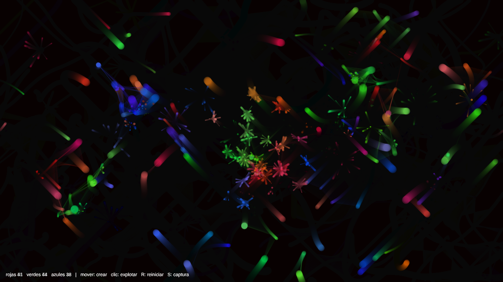

# Burbujas

Obra generativa audiovisual hecha con p5.js y p5.sound: un pequeño ecosistema de burbujas de colores que se persiguen, se contagian y estallan.

## Cómo ejecutarlo

Abrir la carpeta con un servidor local (por ejemplo la extensión **Live Server** de VS Code) y cargar `index.html`. Si se abre el archivo con doble clic, p5.sound no puede cargarse y el sketch no arranca. También funciona subiendo los archivos al editor web de p5.js.

| Acción | Efecto |
| --- | --- |
| Mover el ratón | Nace una burbuja cada 20 px y las cercanas se acercan al ratón |
| Clic | Explotan las burbujas cercanas al ratón (el primer clic activa el sonido) |
| `R` | Reinicia el sistema |
| `S` | Guarda una captura |

## Concepto e intención visual

Un fondo oscuro, como agua de noche, en el que flotan burbujas luminosas muy pequeñas. Ninguna familia gana: cada una persigue a otra y es perseguida por la tercera, así que el color dominante va cambiando sin parar. El espectador no dirige nada; solo remueve el agua con el ratón y revienta lo que tiene cerca. La sensación buscada es la de mirar un acuario: calma, con pequeños sobresaltos.

## Familias de agentes

Hay entre 90 y 150 burbujas, repartidas en tres familias. Todas miden entre 2 y 10 px de radio y su transparencia nunca supera el 50 %.

| Familia | Color | Timbre al sonar |
| --- | --- | --- |
| Rojas | Canal rojo alto, los otros bajos | Onda senoidal (`sine`) |
| Verdes | Canal verde alto | Onda triangular (`triangle`) |
| Azules | Canal azul alto | Onda cuadrada (`square`) |

## Reglas de relación

Cada burbuja mira a las que tiene a menos de 80 px:

1. **Atracción**: persigue a su presa (rojas → verdes → azules → rojas).
2. **Repulsión**: huye de la familia que la persigue.
3. **Transformación de color**: si toca a su presa, la presa pasa a ser de su familia y cambia de color. La que contagia crece un poco.
4. **Conexión**: una línea fina une a las burbujas cercanas de la misma familia.

## Implementación

El código está repartido en un archivo por objeto:

- `sketch.js`: programa principal (`setup`, `draw`, ratón y teclado) y los valores generales.
- `Burbuja.js`: el agente.
- `Particula.js`: el sistema secundario de partículas.
- `Sonido.js`: todo el sonido.

**Movimiento.** Cada burbuja tiene posición y velocidad. En cada fotograma `noise()` le da un ángulo que cambia suavemente y la burbuja acelera un poco en esa dirección. La velocidad se limita con `constrain()`. Al salir por un borde entra por el contrario.

**Partículas.** Cada contagio lanza 4 partículas y cada explosión 10, del color de la burbuja. Salen en una dirección aleatoria, se frenan y pierden opacidad hasta desaparecer. Además, el fondo se pinta semitransparente, así que todo lo que se mueve deja rastro.

**Interacción.** Mover el ratón crea burbujas y atrae a las que están a menos de 300 px, pero solo mientras se mueve. El clic revienta las que están a menos de 150 px. El ratón perturba pero no controla: las burbujas siguen con sus propias reglas.

**Sonido.** Se genera con osciladores (`p5.Oscillator`), sin archivos de audio. Cuando una burbuja estalla suena una nota: la familia decide el timbre y el tamaño decide la altura (pequeña = aguda, grande = grave). Los contagios suenan igual pero más cortos y flojos. De fondo hay un zumbido cuyo volumen depende del número de burbujas y cuya altura depende de su velocidad media.

**Evolución.** Las burbujas envejecen y estallan solas al cabo de entre 20 y 60 segundos. Si quedan menos de 90, nacen nuevas de una familia al azar. El reparto entre familias oscila continuamente y el fondo se tiñe ligeramente del color de la familia más numerosa.

## Decisiones estéticas

- Burbujas muy pequeñas y semitransparentes sobre negro, para que el color se sume donde se juntan.
- Rastros largos en lugar de formas nítidas: se ve el recorrido más que el objeto.
- Solo tres colores base, uno por familia, para que se lea de un vistazo quién domina.

## Dificultades encontradas

- La idea inicial era que todas las burbujas estallaran con cada clic, pero eso dejaba el sistema vacío y por debajo de los 90 agentes. Se resolvió limitando la explosión a un radio alrededor del ratón y rellenando poco a poco hasta 90.
- Si el ratón podía crear burbujas sin límite se superaban los 150 agentes. Ahora, al llegar al máximo, la más vieja estalla para dejar sitio a la nueva.
- p5.sound no funciona abriendo `index.html` directamente desde el disco; hace falta un servidor local.

_(Añadir aquí las dificultades propias al trabajar el código.)_

## Ideas futuras

- Usar grabaciones reales de estallidos en lugar de osciladores.
- Que las burbujas muten de forma después de varios contagios.
- Mover el sonido de izquierda a derecha según la posición de la burbuja.

## Uso de herramientas de IA

Se ha utilizado Claude (Anthropic) para generar la estructura del código y un borrador de este README. Indicaciones empleadas:

- Se le pasó el enunciado completo de la práctica como contexto.
- Se le pidió usar las funciones más simples posibles de la referencia de p5.js, organizar el código con objetos y separar cada objeto en un archivo `.js`.
- Se le describió la idea: burbujas que nacen cuando el ratón se mueve más de 20 px, de tamaño aleatorio entre 2 y 10 px, color RGB variable con transparencia máxima del 50 %, que se acercan al movimiento del ratón, estallan con el clic y suenan de forma distinta al estallar.

Las tres familias por color, la regla circular de persecución y el sonido con osciladores fueron propuestas de la IA para cumplir los requisitos del enunciado.

Material de la sesión: [Sesión 10 · Entrega y presentación de AC-02](../../README.md).
